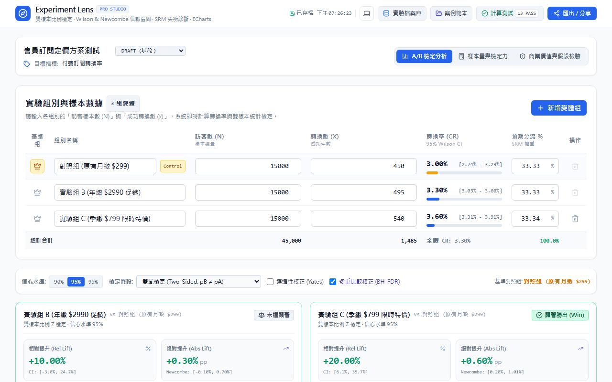
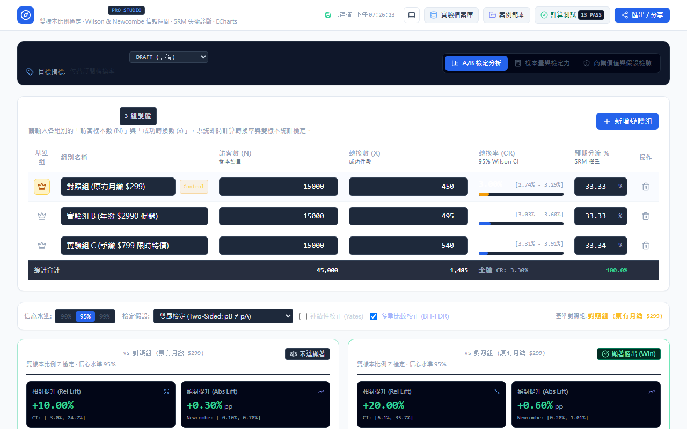

# Experiment Lens

<p align="center">
  <strong>English</strong> · [繁體中文](README.zh-TW.md)
</p>

> **Experiment Lens** is a **professional A/B testing analysis and statistical decision studio** engineered for product managers, data analysts, and growth engineers. It features rigorous two-sample hypothesis testing, Wilson Score and Newcombe Hybrid confidence intervals, Sample Ratio Mismatch (SRM) diagnostics, power curve planning, business ROI evaluation, and offline IndexedDB persistence.

<p align="center">
  
</p>

<p align="center">
  
  
  
  
  
  
  
  
  
</p>

<p align="center">
  <a href="https://github.com/ReiKama414/experiment-lens">GitHub Repository</a> · 
  <a href="https://reikama414.vercel.app/">Portfolio</a> · 
  <a href="#quick-start">Quick Start</a> · 
  <a href="#workflow">Workflow</a> · 
  <a href="#license">License</a>
</p>

---

## Why Experiment Lens

When evaluating online experiments, teams frequently stumble into standard pitfalls: degenerate Wald confidence intervals at extreme proportions, undetected Sample Ratio Mismatch (SRM) invalidating random assignment, continuous monitoring ("peeking") inflating false positives, or treating minor statistical significance as real-world business value.

Experiment Lens bridges mathematical rigor with actionable business intuition. All calculations run client-side in the browser, safeguarding proprietary experiment data without requiring third-party cloud APIs.

---

## Highlights

- **High-Precision Hypothesis Testing** — Two-sample Z-test with pooled standard error, two-sided and one-sided alternatives, and optional Yates continuity correction.
- **Robust Confidence Intervals** — Wilson Score intervals for group proportions, Newcombe Hybrid Score intervals for absolute lift ($\Delta p$), and Delta Method log-scale intervals for relative lift.
- **Multiple Comparison Guardrails** — Benjamini-Hochberg (FDR) and Bonferroni corrections for multi-variant (A/B/n) experiments.
- **SRM Sample Ratio Mismatch Diagnostic** — Pearson $\chi^2$ goodness-of-fit test detecting traffic routing anomalies, caching discrepancies, or tracking loss before decisions are made.
- **Zero-Overlap Five-Layer Document Flow** — Strict card structure: Header $\to$ Description $\to$ Statistics $\to$ Chart $\to$ Footer, eliminating overlapping text over canvas elements.
- **Interactive Apache ECharts** — High-definition Gaussian sampling distributions, confidence interval forest plots, and statistical power curves with instant PNG export.
- **Business ROI & Decision Guardrails** — Financial ROI calculator converting percentage lifts to gross profit and payback periods, paired with assumption checklists for peeking bias, novelty effects, and randomization unit consistency.
- **Full RWD & Dual Themes** — Verified across 9 viewports (320px to 1920px) with zero horizontal overflow, supporting System, Light, and Dark modes.
- **Client-Side IndexedDB Storage** — Account-free persistent local database with search, tags, JSON import/export, and stateless compressed URL hash sharing.

---

## Tech Stack

| Domain | Technology | Description |
| --- | --- | --- |
| Core Framework | React 19 · TypeScript 5 | Strict type safety, modular component architecture, and custom hooks |
| Build Tool | Vite 6 | High-speed HMR dev server and optimized tree-shaken production bundles |
| Styling | Tailwind CSS | Bloomberg-style high-contrast data workstation aesthetics and dual theme variables |
| Charting | Apache ECharts · echarts-for-react | Canvas/SVG rendering, theme adaptation, marklines, and interactive tooltips |
| Persistence | IndexedDB (`idb`) | Client-side sandbox structured storage without external backend servers |
| Iconography | Lucide React | Clean, consistent linear icon set |
| Verification | Vitest · Playwright | 16 mathematical unit tests and 30 end-to-end multi-viewport tests |

---

## Quick Start

### Prerequisites

- Node.js 20+ or 22+
- npm 10+
- Modern desktop or mobile browser (Chrome, Edge, Safari, Firefox)

### Installation & Launch

```bash
# Clone the repository
git clone https://github.com/ReiKama414/experiment-lens.git
cd experiment-lens

# Install dependencies
npm install

# Start local development server
npm run dev
```

Open the printed local URL (default: `http://localhost:5173`) in your browser.

### Production Build

```bash
# Type check and build bundle
npm run build

# Preview production build locally
npm run preview
```

---

## Workflow

```
Input Data (Manual / Import) → Statistical Testing & SRM Check → ECharts Visual Analysis → Business ROI Evaluation → Export Decision Report
```

1. **Select or Create Experiment**: Switch between built-in presets (E-commerce Checkout, SaaS Signup, Multi-tier Pricing) or click "新實驗" (New Experiment) to clear inputs.
2. **Enter Sample Sizes & Conversions**: Fill in variant names, sample sizes ($N$), and conversions ($x$). Use "＋新增變體" to add multiple variants.
3. **Inspect SRM Diagnostic**: Review the SRM badge in the overview panel. If $p < 0.001$, traffic assignment is compromised; engineering fixes are required before analyzing results.
4. **Deep-Dive Statistics**:
   - Choose test direction (two-tailed, one-tailed greater, one-tailed less) and significance level $\alpha$.
   - Enable continuity correction or Benjamini-Hochberg FDR correction.
   - Inspect Wilson Score intervals, Newcombe difference intervals, and Beta-Binomial Bayesian win probabilities.
5. **Sample Size & Power Planning**: Switch to "樣本量與檢定力" (Sample Size & Power) to calculate required sample size, duration, and the power curve based on MDE and daily traffic.
6. **Business Significance Guardrails**: Switch to "商業價值評估" (Business Guardrails) to compute net monetary gain and check assumptions against novelty effects and peeking bias.
7. **Export & Share**: Open "匯出／分享" (Export & Share) to download CSV data, copy formatted Markdown reports, export JSON backups, or share compressed URL hashes.

---

## Project Structure

```
experiment-lens/
├── assets/                  # Project assets and screenshot specifications
│   ├── screenshots/         # Light and dark mode workbench captures
│   └── ASSET_REQUESTS.md    # Image asset requests
├── src/
│   ├── components/          # UI components
│   │   ├── charts/          # ECharts distribution, forest, and power charts
│   │   ├── BusinessValueGuardrails.tsx # Business ROI and assumption checklist
│   │   ├── ExperimentManagerModal.tsx  # IndexedDB local storage modal
│   │   ├── Header.tsx                  # Navigation and theme switch
│   │   ├── ResultsOverview.tsx         # Primary metrics and SRM check
│   │   ├── SampleSizeCalculator.tsx    # Power calculator and planner
│   │   ├── ShareExportModal.tsx        # Report export and URL sharing
│   │   ├── StatisticalDeepDive.tsx     # Detailed hypothesis tests
│   │   ├── VariantTable.tsx            # Data input table
│   │   ├── VerificationModal.tsx       # Mathematical baseline verification
│   │   └── VisualDistributions.tsx     # 5-layer document flow charts
│   ├── context/             # Theme context (System / Light / Dark)
│   ├── db/                  # IndexedDB persistence layer
│   ├── types/               # TypeScript interfaces
│   └── utils/               # Statistical engine (stats, fileIO, presets, export)
├── tests/                   # Automated test suites
│   ├── stats.test.ts        # Mathematical unit tests
│   ├── fileIO.test.ts       # Defensive parser unit tests
│   └── e2e/                 # Playwright E2E and responsive suites
├── index.html               # Application HTML entry
├── vite.config.ts           # Vite configuration
└── tailwind.config.js       # Tailwind CSS theme setup
```

---

## Screenshots

<p align="center">
  
</p>
<p align="center"><em>Light Mode — High-Contrast Data Workstation</em></p>

<p align="center">
  
</p>
<p align="center"><em>Dark Mode — Immersive Dark Workstation</em></p>

---

## Testing & Verification

The project is safeguarded by two tiers of automated tests:

### 1. Unit Tests (Vitest)

Verifies mathematical precision, boundary conditions, and file fault tolerance:

```bash
npm run test
```

- **16 Unit Tests Passed (100%)**:
  - Standard normal CDF and inverse CDF precision ($< 10^{-6}$).
  - Wilson Score non-degeneracy at boundary conditions ($x=0$ and $x=N$).
  - Newcombe Hybrid Score difference coverage.
  - Delta Method log-scale relative lift transformation.
  - Pearson $\chi^2$ goodness-of-fit and SRM detection.
  - File parser fault tolerance: empty files, missing columns, non-integer values, $x > N$, and delimiter auto-detection.

### 2. End-to-End & Layout Tests (Playwright)

Validates user interactions, 9 viewport responsive layouts, zero-overlap geometry, and theme switching:

```bash
npm run test:e2e
```

- **30 E2E Tests Passed (100%)**:
  - **9 Viewport RWD Zero Horizontal Overflow**: 320px, 375px, 390px, 430px, 768px, 1024px, 1280px, 1440px, and 1920px.
  - **Zero-Overlap Policy Enforcement**: Strict non-intersection checks across Header, Description, Statistics, Chart, and Footer bounding boxes.
  - **200% Browser Zoom Scaling**: Natural card expansion without clipped content.
  - **Theme System**: Immediate System, Light, and Dark switching with persistent state.

---

## Deployment

The application is pre-configured for static hosting on GitHub Pages, Vercel, or Cloudflare Pages.

### Deploying to GitHub Pages

A ready-to-run GitHub Actions workflow is provided at `.github/workflows/deploy.yml`:

1. Push code to your GitHub repository:
   ```bash
   git add .
   git commit -m "feat: complete production-ready Experiment Lens studio"
   git push origin main
   ```
2. In your GitHub repository, navigate to **Settings → Pages**.
3. Under **Build and deployment → Source**, select **GitHub Actions**.
4. Once the workflow finishes, the site is live.

---

## Known Limitations

> **Note:** Please review the following mathematical and architectural considerations before drawing conclusions.

1. **Binary Proportions Only** — Designed specifically for Bernoulli conversion metrics (CTR, conversion rate, signup rate). For continuous metrics (AOV, ARPU, session duration), use Two-Sample T-tests, Welch's T-test, or non-parametric bootstrap resampling instead of binary proportion formulas.
2. **Unit of Randomization** — The sample denominator must represent independent users (User ID or persistent Cookie ID), not sessions or page views. Correlated visits inflate false positives and underestimate standard errors.
3. **Network Effects & Interference** — Tests assume SUTVA (Stable Unit Treatment Value Assumption). If users interact within social networks or two-sided marketplaces, cluster randomization or switchback testing should be applied.
4. **Local Sandbox Persistence** — Data is stored within the browser's IndexedDB sandbox. Clearing browser history or operating in private/incognito mode will not retain saved experiments. Use "匯出／分享" (Export & Share) to generate JSON backups.

---

## License

Copyright (c) 2026 ReiKama414. All rights reserved.

This project is provided solely for personal viewing and learning purposes. No permission is granted to use, copy, modify, distribute, or incorporate this software into other projects (including non-commercial use) without prior written consent.

- [GitHub Repository](https://github.com/ReiKama414/experiment-lens)
- [Portfolio](https://reikama414.vercel.app/)
- [Full License](./LICENSE)

---

<p align="center">
  <sub>Experiment Lens · Professional A/B Testing Analysis & Statistical Decision Studio</sub>
</p>
