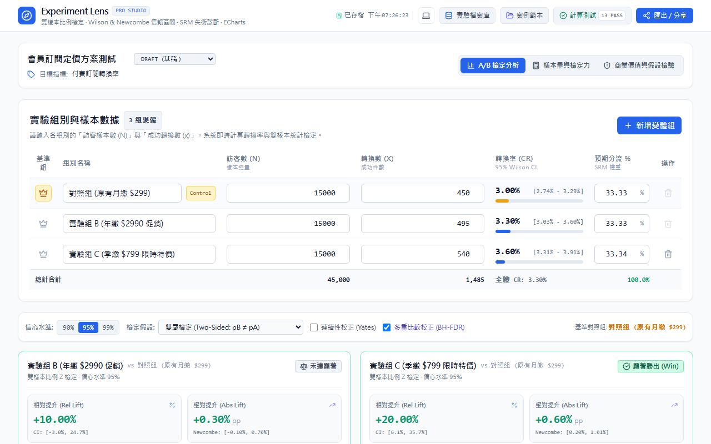
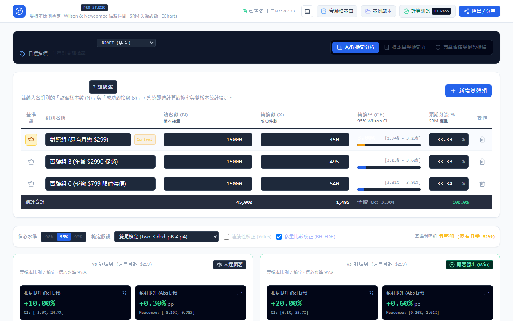

# Experiment Lens

<p align="center">
  [English](README.md) · <strong>繁體中文</strong>
</p>

> **Experiment Lens** 是一套專為產品經理、資料分析師與成長工程師打造的**專業級 A/B 測試分析與統計決策工作台**，整合嚴謹的雙樣本比例假設檢定、Wilson & Newcombe 信賴區間、SRM 樣本比例失衡偵測、檢定力曲線規劃、商業價值 ROI 試算與本機資料庫持久化

<p align="center">
  
</p>

<p align="center">
  
  
  
  
  
  
  
  
  
</p>

<p align="center">
  <a href="https://github.com/ReiKama414/experiment-lens">GitHub 倉庫</a> · 
  <a href="https://reikama414.vercel.app/">個人網站</a> · 
  <a href="#快速開始">快速開始</a> · 
  <a href="#操作流程">操作流程</a> · 
  <a href="#license--權限">授權說明</a>
</p>

---

## 為什麼做

許多團隊在解讀 A/B 測試時，常落入傳統 Wald 信賴區間坍縮、忽視 SRM 樣本比例失衡、頻繁偷看數據提早終止，或把微小的統計顯著誤當作商業獲利的陷阱

Experiment Lens 的目標是提供一個兼具數學精度、防禦性警報與商業決策輔助的專業工作台。所有計算均在瀏覽器本機端即時運算，不依賴任何外部雲端 API，保護實驗機密不外洩

---

## 核心亮點

- **高精度比例統計檢定** — 採用雙樣本 Z 檢定（Pooled SE），支援雙尾、單尾與 Yates 連續性校正
- **穩健區間估計** — 各組轉換率採用 Wilson Score 區間，差值採用 Newcombe Hybrid 區間，相對提升採用 Delta Method 對數區間，避免 Wald 區間在極端比例下失準
- **多重比較防護** — 支援 Benjamini-Hochberg（FDR）偽發現率與 Bonferroni 校正，多變體實驗不再累積型一誤差
- **SRM 樣本比例失衡偵測** — 內建 Pearson 卡方適合度檢定，在流量分配偏離預期時即時亮起技術警報，阻止受污染數據誤導決策
- **五階 Document Flow 零重疊排版** — 圖表卡片遵循 Header → Description → Statistics → Chart → Footer 順序，完全不使用絕對定位文字覆蓋圖表
- **ECharts 互動視覺化** — 繪製抽樣分佈常態鐘型曲線、信賴區間森林圖與檢定力衰減曲線，支援高解析度圖表輸出
- **商業價值與決策防禦** — 內建 ROI 試算器與假設檢核清單，計算超額毛利並提醒防範新奇效應、星期幾效應與隨機單位不一致
- **全響應式與雙主題** — 支援 320px 至 1920px 共 9 種 Viewport，提供 System、Light 與 Dark 模式，切換無閃爍
- **本機 IndexedDB 持久化** — 免註冊帳號即可儲存、檢索、複製與批次備份實驗，並支援無狀態 URL 雜湊分享

---

## 技術棧

| 領域 | 技術項目 | 說明 |
| --- | --- | --- |
| 核心框架 | React 19 · TypeScript 5 | 高型別安全、組件化介面與自訂 Hooks |
| 建置工具 | Vite 6 | 高速開發伺服器與最佳化靜態打包 |
| 樣式架構 | Tailwind CSS | 實作灰階高對比專業數據介面與雙主題變數 |
| 圖表繪製 | Apache ECharts · echarts-for-react | 自適應主題、高清晰 Canvas/SVG 與標記線 |
| 本機儲存 | IndexedDB (`idb`) | 瀏覽器沙盒結構化儲存，無須外部後端 |
| 圖示庫 | Lucide React | 統一風格的專業線性圖示 |
| 測試驗證 | Vitest · Playwright | 16 個數學單元測試與 30 個全解析度 E2E 驗證 |

---

## 快速開始

### 環境需求

- Node.js 20+ 或 22+
- npm 10+
- 支援現代標準的桌面或行動瀏覽器（Chrome、Edge、Safari、Firefox）

### 安裝與啟動

```bash
# 複製專案庫
git clone https://github.com/ReiKama414/experiment-lens.git
cd experiment-lens

# 安裝依賴套件
npm install

# 啟動本機開發伺服器
npm run dev
```

啟動後於瀏覽器開啟印出的本機網址（預設為 `http://localhost:5173`）

### 正式建置

```bash
# 型別檢查與生產打包
npm run build

# 本機預覽建置產物
npm run preview
```

---

## 操作流程

```
數據輸入（手動／匯入）→ 統計檢定與 SRM 診斷 → ECharts 圖表分析 → 商業 ROI 評估 → 匯出決策報告
```

1. **選擇或建立實驗**：在頂部工作台可切換預設案例（電子商務結帳流程、SaaS 註冊按鈕、多變體定價頁面），或點擊「新實驗」清空表單
2. **輸入樣本與轉換數**：填入各組別名稱、訪客數（Sample Size $N$）與成功轉換數（Conversions $x$）。可點擊「＋新增變體」擴展多組 A/B/n 測試
3. **檢查 SRM 技術指標**：觀察組別概覽區的 SRM 卡方檢定。若 $p < 0.001$，表示分流過程有快取、追蹤丟失或伺服器異常，請先修復工程問題再下結論
4. **深入統計檢定細節**：
   - 選擇檢定模式（雙尾檢定、單尾大於、單尾小於）與顯著水準 $\alpha$（預設 0.05）
   - 開啟連續性校正或 Benjamini-Hochberg FDR 校正
   - 檢視 Wilson Score 區間、Newcombe 差值區間與 Beta-Binomial 貝氏勝率
5. **檢定力與樣本量規劃**：切換至「樣本量與檢定力」分頁，輸入基準轉換率、MDE 與每日流量，查看預估天數與檢定力曲線
6. **商業價值守衛**：切換至「商業價值評估」分頁，輸入月流量、客單價、毛利率與工程維護成本，確認顯著結果是否足以打平成本
7. **匯出與分享**：點擊「匯出／分享」，可下載 CSV 數據表、複製 Markdown 決策簡報、匯出 JSON 備份，或複製含有壓縮狀態的 URL 連結分享給團隊成員

---

## 專案結構

```
experiment-lens/
├── assets/                  # 專案靜態截圖與素材規範
│   ├── screenshots/         # 亮色與暗色工作台截圖
│   └── ASSET_REQUESTS.md    # 圖像資產規格
├── src/
│   ├── components/          # 視覺化介面元件
│   │   ├── charts/          # ECharts 圖表封裝（分佈圖、森林圖、檢定力曲線）
│   │   ├── BusinessValueGuardrails.tsx # 商業價值試算與假設防禦
│   │   ├── ExperimentManagerModal.tsx  # IndexedDB 實驗管理彈窗
│   │   ├── Header.tsx                  # 頂部導覽列與主題切換
│   │   ├── ResultsOverview.tsx         # 核心指標與 SRM 診斷
│   │   ├── SampleSizeCalculator.tsx    # 樣本量計算器與曲線
│   │   ├── ShareExportModal.tsx        # 報告匯出與 URL 分享
│   │   ├── StatisticalDeepDive.tsx     # 統計檢定矩陣與參數調整
│   │   ├── VariantTable.tsx            # 組別數據輸入與多變體管理
│   │   ├── VerificationModal.tsx       # 內建數學基準自主驗證
│   │   └── VisualDistributions.tsx     # 零重疊 5 階圖表佈局
│   ├── context/             # 主題與全域狀態（System / Light / Dark）
│   ├── db/                  # IndexedDB 本機儲存庫層
│   ├── types/               # TypeScript 資料模型
│   └── utils/               # 核心計算函式庫（stats, fileIO, presets, export）
├── tests/                   # 自動化測試套件
│   ├── stats.test.ts        # 統計演算法單元測試
│   ├── fileIO.test.ts       # 檔案容錯解析測試
│   └── e2e/                 # Playwright 端到端與 RWD 驗證
├── index.html               # 應用程式入口
├── vite.config.ts           # Vite 建置配置
└── tailwind.config.js       # 樣式與雙主題設定
```

---

## 截圖展示

<p align="center">
  
</p>
<p align="center"><em>亮色模式 — 高對比數據工作台</em></p>

<p align="center">
  
</p>
<p align="center"><em>暗色模式 — 深色沈浸工作台</em></p>

---

## 測試驗證

本專案實施嚴格的雙層自動化測試，確保統計數據可信且介面在所有設備均不跑版

### 1. 單元測試（Vitest）

涵蓋統計公式精度、邊界值收斂、極端比例與檔案容錯處理：

```bash
npm run test
```

- **16 項單元測試 100% 通過**：
  - 標準常態分佈 CDF 與逆 CDF 精度達 $10^{-6}$
  - Wilson Score 在 $x=0$ 與 $x=N$ 邊界非簡併性
  - Newcombe Hybrid Score 差值覆蓋度驗證
  - Delta Method 相對提升對數轉換與標準誤推導
  - Pearson 卡方適合度與 SRM 警報判定
  - 檔案解析防禦：空檔案、欄位缺失、非整數、轉換數大於樣本數（$x > N$）與分隔符相容性

### 2. 端到端與視覺佈局測試（Playwright）

驗證使用者互動、9 種 Viewport 響應排版、零重疊幾何檢測與主題切換：

```bash
npm run test:e2e
```

- **30 項 E2E 測試 100% 通過**：
  - **9 種 Viewport 零水平溢出**：320px、375px、390px、430px、768px、1024px、1280px、1440px、1920px
  - **Zero-Overlap 政策驗證**：圖表與卡片 5 階層 Bounding Box 嚴格非相交，文字不遮擋圖表
  - **200% 文字放大相容**：高倍率縮放排版自然延展
  - **主題系統響應**：System、Light、Dark 即時切換與持久化

---

## 部署說明

本專案支援靜態託管（GitHub Pages、Vercel 或 Cloudflare Pages）

### 部署至 GitHub Pages

儲存庫已內置 GitHub Actions 自動部署工作流程檔 `.github/workflows/deploy.yml`

1. 將程式碼推送到 GitHub 儲存庫：
   ```bash
   git add .
   git commit -m "feat: complete production-ready Experiment Lens studio"
   git push origin main
   ```
2. 前往 GitHub 儲存庫的 **Settings → Pages**
3. 在 **Build and deployment → Source** 選擇 **GitHub Actions**
4. 部署工作流程完成後即可透過 GitHub Pages 網址線上使用

---

## 已知限制與適用範圍

> **提醒：** 進行統計決策前，請詳閱下列數學與架構限制

1. **二元轉換指標專用** — 本工具專為二元伯努利事件（點擊率、轉化率、留存率）設計。若指標為連續型數值（客單價、停留時間、每人營收），應採用雙樣本 T 檢定或 Bootstrap 重抽樣法，不可直接套用本比例模型
2. **隨機分流單位一致性** — 訪客數分母必須是獨立使用者（User ID 或 Cookie ID），不可使用造訪次數（Sessions）或點擊次數作為分母，否則會產生偽重複抽樣並低估標準誤
3. **網絡效應與外部干擾** — 本檢定建立於 SUTVA 假設。若產品具社交互動或雙邊市場效應，實驗組與對照組個體可能互相干擾，建議改採叢集成群抽樣或分區切換
4. **本機儲存沙盒邊界** — 實驗數據保存於當前瀏覽器 IndexedDB 沙盒。若手動清除瀏覽紀錄或開啟無痕視窗，儲存資料將無法還原，請善用「匯出／分享」定期備份 JSON 檔案

---

## License / 權限

Copyright (c) 2026 ReiKama414. All rights reserved.

本專案僅供個人瀏覽與學習。未經著作權人書面同意，不得使用、複製、修改、散布或併入其他專案（含非商業用途）

- [GitHub 倉庫](https://github.com/ReiKama414/experiment-lens)
- [個人網站](https://reikama414.vercel.app/)
- [授權全文](./LICENSE)

---

<p align="center">
  <sub>Experiment Lens · 專業級 A/B 測試分析與統計決策工作台</sub>
</p>
